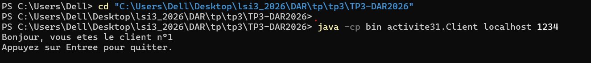
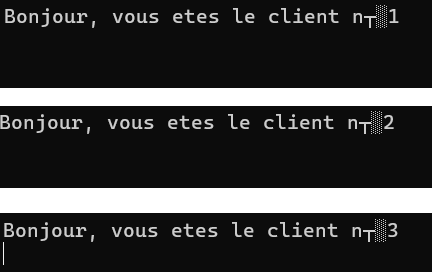
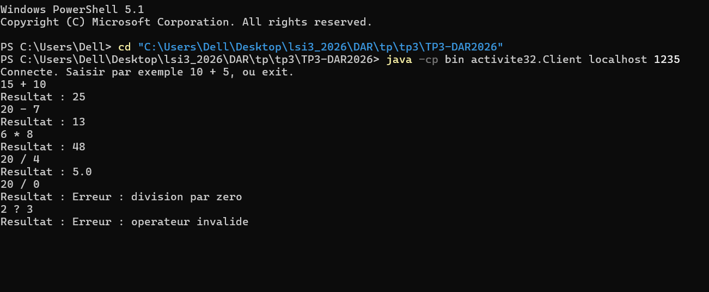
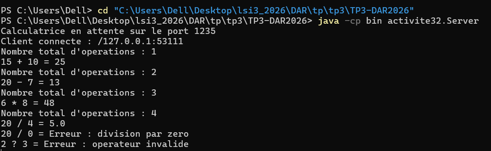

# TP3 – Développement d'Applications Réparties

**Faculté des Sciences de Sfax (FSS)**  
**Filière :** LSI3  
**Année universitaire :** 2026-2027  
**Matière :** Développement d'applications réparties  
**Enseignante TP :** Mme Zeineb DAOUD

**TP3 : Serveur Multi-threads – Sockets TCP**

## 1. Présentation du TP

L'objectif de ce TP est de développer un serveur TCP capable de communiquer avec plusieurs clients en même temps.

Dans les TP précédents, le serveur traitait un seul client à la fois. Ici, j'ai utilisé les threads pour permettre à chaque client d'avoir son propre traitement.

Le travail est divisé en deux activités :

- **Activité 3-1 :** accepter plusieurs clients simultanément et attribuer un numéro à chaque connexion.
- **Activité 3-2 :** améliorer la calculatrice du TP2 pour permettre à plusieurs clients d'effectuer des calculs en parallèle.

## 2. Organisation du projet

Le projet contient sept classes Java réparties dans deux packages :

```text
TP3-DAR2026/
│
├── src/
│   ├── activite31/
│   │   ├── Server.java
│   │   ├── Client.java
│   │   └── ClientProcess.java
│   │
│   └── activite32/
│       ├── Server.java
│       ├── Client.java
│       ├── ClientProcess.java
│       └── Operation.java
│
├── docs/
│   └── screenshots/
│
├── .gitignore
└── README.md
```

J'ai utilisé uniquement les bibliothèques standard de Java, sans dépendances externes.

**Environnement utilisé :** Windows 11, PowerShell et JDK 21.

## 3. Compilation du projet

Depuis le dossier `TP3-DAR2026`, ouvrir PowerShell et exécuter :

```powershell
New-Item -ItemType Directory -Path bin -Force | Out-Null
javac -encoding UTF-8 -d bin (Get-ChildItem -Path src -Recurse -Filter *.java | ForEach-Object FullName)
```

Les fichiers compilés sont placés dans le dossier `bin/`.

## 4. Activité 3-1 : Acceptation de plusieurs clients

### Fonctionnement

Dans cette première activité, j'ai créé un serveur TCP qui écoute sur le port `1234`.

À chaque nouvelle connexion, le serveur :

1. Accepte le client avec `accept()`.
2. Récupère son adresse IP et son port.
3. Lui attribue un numéro de connexion.
4. Crée un thread `ClientProcess` pour le gérer.
5. Envoie son numéro au client.

Grâce aux threads, plusieurs clients peuvent rester connectés sans bloquer le serveur.

### Lancement du serveur

Dans un premier terminal PowerShell :

```powershell
java -cp bin activite31.Server
```

### Lancement du client

Dans un deuxième terminal :

```powershell
java -cp bin activite31.Client localhost 1234
```

### Test avec plusieurs clients

J'ai testé le serveur avec plusieurs connexions simultanées.

Chaque client a reçu un numéro différent et le serveur a affiché son adresse IP et son port.



J'ai également ouvert trois clients simultanément pour vérifier que le serveur pouvait les gérer en parallèle.



### Test avec Telnet

J'ai utilisé le client Telnet de Windows pour tester la connexion TCP :

```powershell
telnet localhost 1234
```

La connexion a réussi et le serveur a envoyé le message suivant :

```text
Bonjour, vous êtes le client n°2
```

Ce test montre que le serveur accepte aussi les connexions provenant de Telnet.


## 5. Activité 3-2 : Calculatrice multi-threads

### Fonctionnement

Dans cette activité, j'ai repris le service de calculatrice du TP2 en utilisant la classe `Operation` qui implémente `Serializable`.

Le client saisit deux nombres et un opérateur (`+`, `-`, `*`, `/`).

L'opération est envoyée au serveur sous forme d'objet grâce à `ObjectOutputStream`.

Le serveur reçoit cet objet avec `ObjectInputStream`, effectue le calcul et renvoie le résultat au client.

Chaque client possède son propre thread `ClientProcess`, ce qui permet de traiter plusieurs calculs en parallèle.

### Lancement du serveur

Dans un premier terminal :

```powershell
java -cp bin activite32.Server
```

Le serveur écoute sur le port `1235`.

### Lancement du client

Dans un deuxième terminal :

```powershell
java -cp bin activite32.Client localhost 1235
```

Le client peut saisir plusieurs opérations sans se déconnecter.

Le format demandé est :

```text
nombre opérateur nombre
```

Par exemple :

```text
15 + 10
```

Pour quitter le client, il suffit de saisir `exit`.

### Tests effectués

J'ai testé les quatre opérations ainsi que quelques cas d'erreur.

| Opération | Résultat obtenu |
|---|---|
| 15 + 10 | 25 |
| 20 - 7 | 13 |
| 6 * 8 | 48 |
| 20 / 4 | 5.0 |
| 20 / 0 | Erreur : division par zéro |
| 2 ? 3 | Erreur : opérateur invalide |

Les calculs fonctionnent correctement et le programme affiche un message d'erreur lorsque l'opération est invalide.



### Gestion du compteur global

Le serveur possède une variable `nombreOperations` qui compte le nombre total d'opérations réussies.

Cette variable est partagée entre les threads des clients.

Pour éviter les problèmes d'accès concurrent, j'ai utilisé une méthode `compterOperation()` déclarée `synchronized`.

Ainsi, un seul thread peut modifier le compteur à la fois.

Lors d'un test automatisé, trois clients ont envoyé chacun 20 additions en parallèle, soit 60 nouvelles opérations.

Avec les 6 opérations valides déjà réalisées, le compteur a atteint **66**, sans perte d'incrémentation constatée.



## 6. Tests sur le réseau local

Les tests précédents ont été effectués sur la même machine avec `localhost`.

Pour tester la communication entre plusieurs ordinateurs, il faut les connecter au même réseau local.

Sur le PC serveur, récupérer l'adresse IPv4 avec :

```powershell
ipconfig
```

Sur un autre PC, vérifier la connexion :

```powershell
Test-NetConnection ADRESSE_IP -Port 1234
```

Puis lancer le client :

```powershell
java -cp bin activite31.Client ADRESSE_IP 1234
```

Pour la calculatrice :

```powershell
java -cp bin activite32.Client ADRESSE_IP 1235
```

**Remarque :** les tests entre plusieurs machines physiques restent à effectuer.

## 7. Synthèse

Ce TP m'a permis de mieux comprendre le fonctionnement d'un serveur TCP multi-threads.

Dans l'activité 3-1, j'ai appris à accepter plusieurs connexions et à utiliser un thread pour chaque client.

Dans l'activité 3-2, j'ai repris la calculatrice du TP2 pour échanger des objets Java et traiter plusieurs demandes en parallèle.

J'ai aussi compris pourquoi il faut utiliser `synchronized` lorsqu'une variable est partagée entre plusieurs threads.

Les tests locaux et le test Telnet ont fonctionné. Il reste à vérifier le fonctionnement entre plusieurs machines du même réseau.

## 8. Dépôt du projet

Le projet est préparé pour être déposé sur GitHub sous le nom :

**TP3-DAR2026**

Le lien du dépôt sera ensuite transmis sur la plateforme ENT.